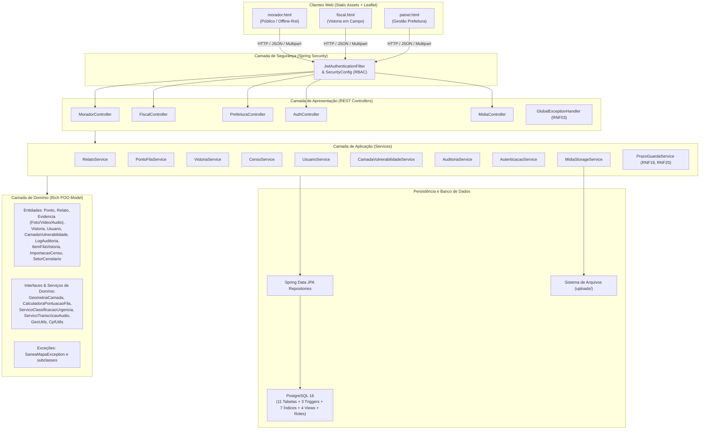
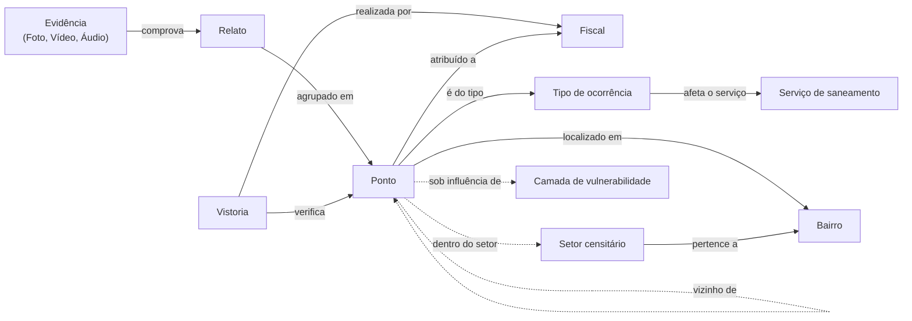

# Arquitetura do Sistema — SaneaMapa

Este documento descreve a arquitetura técnica, a organização em camadas, a aplicação dos **4 Pilares de Programação Orientada a Objetos (POO)**, a modelagem de banco de dados e a estratégia de segurança do **SaneaMapa**.

---

## 1. Visão Geral e Stack Tecnológica

O SaneaMapa adota uma arquitetura **monolítica modular em camadas (Layered Architecture + Rich Domain Model)**, servindo tanto uma API REST quanto a interface web estática no mesmo serviço Spring Boot, persistindo dados em **PostgreSQL 16**.

| Camada | Tecnologias Utilizadas |
|---|---|
| **Frontend Web** | HTML5, CSS3 (`ds/bundle.css`, `css/app.css`), JavaScript Vanilla, **Leaflet / OpenStreetMap** |
| **API & Segurança** | **Java 21**, **Spring Boot 3.4.5** (Web, Validation, Security), **JJWT 0.11.5** (JWT Stateless), **BCrypt** |
| **Domínio & Persistência** | Modelo de Domínio Rico (POO), **Spring Data JPA / Hibernate** |
| **Banco de Dados** | **PostgreSQL 16** (DDL com 4 integridades, Triggers, Índices, Roles/Permissões, Views) |
| **Testes** | **JUnit 5**, Spring Boot Test, MockMvc, **H2** em memória (`application-test.yml`) |
| **Infraestrutura** | **Docker** & **Docker Compose** (`postgres:16-alpine` + `eclipse-temurin:21-jre`) |

---

## 2. Diagrama de Arquitetura



---

## 3. Estrutura de Pacotes (`saneamapa-app`)

```text
saneamapa-app/
├── database/                         # Scripts PostgreSQL puros (01 a 06) + ENTREGA_3AF_SQL.md
└── src/
    ├── main/
    │   ├── java/br/edu/cesmac/saneamapa/
    │   │   ├── SaneaMapaApplication.java
    │   │   ├── config/               # DataInitializer (bootstrap inicial)
    │   │   ├── controller/           # Endpoints REST + GlobalExceptionHandler
    │   │   ├── domain/
    │   │   │   ├── enums/            # StatusPonto, TipoOcorrencia, PerfilUsuario, NivelUrgencia, etc.
    │   │   │   ├── exception/        # Hierarquia SaneaMapaException
    │   │   │   ├── model/            # Entidades ricas + interfaces de geometria
    │   │   │   ├── ontologia/        # Classes, relações e grafo de conhecimento (Seção 7)
    │   │   │   └── service/          # Interfaces de domínio, estratégias e utilitários (GeoUtils, CpfUtils)
    │   │   ├── dto/                  # Records Java para entrada/saída (Admin, Auth, Fiscal, Painel, Relato)
    │   │   ├── repository/           # Interfaces JpaRepository
    │   │   ├── security/             # JwtService, JwtAuthenticationFilter, SecurityConfig, UsuarioAutenticado
    │   │   └── service/              # Orquestração transacional e casos de uso
    │   └── resources/
    │       ├── application.yml       # Configuração JPA, JWT, pesos da fila e multipart
    │       └── static/               # Frontend (index.html, morador.html, fiscal.html, painel.html, js/, css/, ds/)
    └── test/
        ├── java/br/edu/cesmac/saneamapa/
        │   ├── DominioPooTest.java
        │   ├── SaneaMapaIntegracaoTest.java
        │   └── service/RelatoServiceDataHoraTest.java
        └── resources/application-test.yml
```

---

## 4. Aplicação dos 4 Pilares de POO

A lógica central de negócio reside nas classes do pacote `br.edu.cesmac.saneamapa.domain`, evitando o antipadrão de modelo anêmico:

| Pilar | Como foi implementado | Arquivos-chave |
|---|---|---|
| **Abstração** | Superclasse abstrata `@MappedSuperclass` para identidade e auditoria temporal (`EntidadeAuditavel`); classe abstrata `Evidencia` definindo o contrato de captura e tratamento LGPD; interfaces de estratégia/geometria (`GeometriaCamada`, `CalculadoraPontuacaoFila`, `ServicoClassificacaoUrgencia`, `ServicoTranscricaoAudio`). | [EntidadeAuditavel.java](saneamapa-app/src/main/java/br/edu/cesmac/saneamapa/domain/model/EntidadeAuditavel.java)<br>[Evidencia.java](saneamapa-app/src/main/java/br/edu/cesmac/saneamapa/domain/model/Evidencia.java)<br>[GeometriaCamada.java](saneamapa-app/src/main/java/br/edu/cesmac/saneamapa/domain/model/GeometriaCamada.java)<br>[CalculadoraPontuacaoFila.java](saneamapa-app/src/main/java/br/edu/cesmac/saneamapa/domain/service/CalculadoraPontuacaoFila.java) |
| **Encapsulamento** | Atributos protegidos/privados com invariantes garantidas em construtores e métodos de negócio (sem setters públicos livres):<br>• `Ponto` encapsula a máquina de estados (`transicionarPara`, `atribuirFiscal`, `aplicarResultadoVistoria`, `registrarVinculoNovoRelato`).<br>• `Relato` exige no construtor nome e telefone com DDD, porque toda denúncia é identificada (RF001), e expõe lista imutável de evidências.<br>• `Usuario` valida CPF/celular, bloqueia após 5 falhas e marca CPF como `updatable = false`.<br>• `Vistoria` valida raio ≤ 100 m contra a posição gravada do ponto e exige câmera.<br>• `LogAuditoria` impede mutação via `@PreUpdate` e `@PreRemove`. | [Ponto.java](saneamapa-app/src/main/java/br/edu/cesmac/saneamapa/domain/model/Ponto.java)<br>[Relato.java](saneamapa-app/src/main/java/br/edu/cesmac/saneamapa/domain/model/Relato.java)<br>[Usuario.java](saneamapa-app/src/main/java/br/edu/cesmac/saneamapa/domain/model/Usuario.java)<br>[Vistoria.java](saneamapa-app/src/main/java/br/edu/cesmac/saneamapa/domain/model/Vistoria.java)<br>[LogAuditoria.java](saneamapa-app/src/main/java/br/edu/cesmac/saneamapa/domain/model/LogAuditoria.java) |
| **Herança** | • Entidades de domínio estendem `EntidadeAuditavel`.<br>• `EvidenciaFoto`, `EvidenciaVideo` e `EvidenciaAudio` estendem `Evidencia` (mapeamento JPA `SINGLE_TABLE` com discriminador `tipo_evidencia`).<br>• `AcessoNegadoException`, `ConflitoDadosException`, `DistanciaVistoriaExcedidaException`, `RecursoNaoEncontradoException` e `RegraNegocioException` estendem `SaneaMapaException`. | [EvidenciaFoto.java](saneamapa-app/src/main/java/br/edu/cesmac/saneamapa/domain/model/EvidenciaFoto.java)<br>[EvidenciaVideo.java](saneamapa-app/src/main/java/br/edu/cesmac/saneamapa/domain/model/EvidenciaVideo.java)<br>[EvidenciaAudio.java](saneamapa-app/src/main/java/br/edu/cesmac/saneamapa/domain/model/EvidenciaAudio.java)<br>[SaneaMapaException.java](saneamapa-app/src/main/java/br/edu/cesmac/saneamapa/domain/exception/SaneaMapaException.java) |
| **Polimorfismo** | • `Relato.adicionarEvidencia(Evidencia)` invoca `validarRegrasCaptura()`, `aplicarTratamentoInicial()` e `descreverTratamento()` polimorficamente para foto (desfoque), vídeo (≤ 30 s, desfoque + remoção de som) e áudio (≤ 60 s, transcrição).<br>• `CamadaVulnerabilidade.obterGeometria()` retorna `GeometriaCamada`, resolvida em tempo de execução por `GeometriaPontoRaio` (Haversine) ou `GeometriaPoligono` (Ray-Casting).<br>• Estratégias de pontuação (`CalculadoraPontuacaoPadrao`), urgência e transcrição programadas contra interfaces. | [GeometriaPontoRaio.java](saneamapa-app/src/main/java/br/edu/cesmac/saneamapa/domain/model/GeometriaPontoRaio.java)<br>[GeometriaPoligono.java](saneamapa-app/src/main/java/br/edu/cesmac/saneamapa/domain/model/GeometriaPoligono.java)<br>[CalculadoraPontuacaoPadrao.java](saneamapa-app/src/main/java/br/edu/cesmac/saneamapa/domain/service/CalculadoraPontuacaoPadrao.java)<br>[DominioPooTest.java](saneamapa-app/src/test/java/br/edu/cesmac/saneamapa/DominioPooTest.java) |

---

## 5. Arquitetura de Segurança e LGPD

1. **Autenticação Stateless (JWT):**
   - `AutenticacaoService` valida credenciais com `BCryptPasswordEncoder`, verifica se o usuário está ativo e não bloqueado, e bloqueia por 15 minutos após 5 erros seguidos (`Usuario.registrarFalhaAutenticacao`).
   - `JwtService` emite tokens assinados (HS256) com expiração configurada em **30 minutos** (`saneamapa.jwt.expiration-minutes: 30`).
2. **Autorização (RBAC):**
   - `SecurityConfig` define acesso público apenas a páginas estáticas, login/redefinição, `POST /api/morador/**` e `GET /api/publico/**`.
   - `GET /api/midias/**` exige `ROLE_FISCAL` ou `ROLE_PREFEITURA`.
   - `/api/fiscal/**` exige `ROLE_FISCAL`; `/api/prefeitura/**` exige `ROLE_PREFEITURA`.
3. **Proteção de Dados Pessoais:**
   - `/api/publico/pontos` nunca retorna `latitude`, `longitude`, `nivelUrgencia`, `nomeMorador`, `telefoneMorador` ou áudios.
   - Todo acesso a contatos, coordenada exata ou áudio por usuários internos gera um registro imutável em `log_auditoria`.
4. **Tratamento Uniforme de Erros (RNF03):**
   - `GlobalExceptionHandler` e `SecurityConfig` convertem exceções de domínio, validação, banco (constraints/triggers) e autenticação para JSON padronizado com `{ "erro", "orientacao" }`.

---

## 6. Arquitetura de Banco de Dados (PostgreSQL)

Os scripts em `saneamapa-app/database/` executam na inicialização do container PostgreSQL:
- **`01_ddl_4_integridades.sql`**: 11 tabelas (`usuario`, `alteracao_usuario`, `ponto`, `relato`, `evidencia`, `item_fila_vistoria`, `camada_vulnerabilidade`, `vistoria`, `importacao_censo`, `setor_censitario`, `log_auditoria`) com integridade de **Entidade**, **Domínio**, **Referencial** e **Semântica**.
- **`02_triggers.sql`**: 3 triggers (`trg_log_auditoria_imutavel`, `trg_ponto_ciclo_vida`, `trg_relato_limite_24h`).
- **`03_indices.sql`**: 7 índices para consultas de mapa, agrupamento por coordenadas, limite de 24h (índice parcial), fila e auditoria.
- **`04_contas_permissoes.sql`**: 3 roles (`role_morador`, `role_fiscal`, `role_prefeitura`) e 3 usuários com privilégio mínimo e proteção por coluna.
- **`05_views.sql`**: 4 views (`vw_fila_vistoria`, `vw_mapa_publico_lgpd`, `vw_indicadores_painel`, `vw_relatorio_auditoria`).
- **`06_seed_dados.sql`**: Carga opcional de demonstração em Maceió/AL.

---

## 7. Ontologia e Grafo de Conhecimento

O domínio também é descrito por uma **ontologia** em código (pacote `domain/ontologia`) e exposto como um **grafo de conhecimento** só de leitura, montado a partir do banco. Nada é gravado: o grafo é uma visão.

| Peça | Papel | Arquivo |
|---|---|---|
| **Classes** | Hierarquia "é um" com 20 conceitos. `Entidade` é a raiz; `Registro`, `Agente`, `Território`, `Conceito` e `Evidência` são abstratas e só agrupam. | [ClasseOntologia.java](../saneamapa-app/src/main/java/br/edu/cesmac/saneamapa/domain/ontologia/ClasseOntologia.java) |
| **Relações** | 13 relações, cada uma com domínio e contradomínio. Dez são declaradas (vêm de chave estrangeira ou atributo) e três são inferidas das geometrias. | [RelacaoOntologia.java](../saneamapa-app/src/main/java/br/edu/cesmac/saneamapa/domain/ontologia/RelacaoOntologia.java) |
| **Grafo** | Nós e arestas tipados pela ontologia. Recusa aresta fora do domínio/contradomínio e nó de classe abstrata ou protegida. Calcula a vizinhança de um nó por número de saltos. | [GrafoConhecimento.java](../saneamapa-app/src/main/java/br/edu/cesmac/saneamapa/domain/ontologia/GrafoConhecimento.java) |
| **Montagem** | Lê pontos, relatos, evidências, vistorias, camadas ativas e setores da importação em uso, e faz as inferências espaciais. | [GrafoConhecimentoService.java](../saneamapa-app/src/main/java/br/edu/cesmac/saneamapa/service/GrafoConhecimentoService.java) |
| **Tela** | Aba **Grafo** do painel: desenho em SVG sem biblioteca externa, filtro por classe, detalhe do nó em texto e as tabelas da ontologia. | [grafo-saneamapa.js](../saneamapa-app/src/main/resources/static/js/grafo-saneamapa.js) |



Linha tracejada é relação **inferida**: o vínculo não existe no banco e é deduzido na montagem (ponto dentro do polígono do setor, ponto dentro da área de uma camada ativa, dois pontos a até 300 m).

**LGPD.** `Morador` é uma classe da ontologia marcada como protegida, e `registrado por` (Relato → Morador) é uma relação declarada, mas o grafo recusa materializar as duas. Os nós não levam nome, telefone nem coordenada exata; esses dados continuam saindo só pelos acessos auditados do painel.

**API** (perfil Prefeitura):
- `GET /api/prefeitura/ontologia`: classes e relações.
- `GET /api/prefeitura/grafo`: grafo inteiro.
- `GET /api/prefeitura/grafo?pontoId={id}&saltos={1..4}`: vizinhança de um ponto (padrão: 2 saltos).

**Testes.** `GrafoConhecimentoTest` cobre subsunção, validação de domínio/contradomínio, recusa de classe abstrata e de dado pessoal, e vizinhança. `GrafoConhecimentoIntegracaoTest` cobre o RBAC, as três inferências com os dados do `DataInitializer` e a ausência de dados pessoais na resposta.

---

## 8. Execução e Implantação

Via Docker Compose na raiz do repositório ([docker-compose.yml](docker-compose.yml)):
```bash
docker compose up --build
```
- **Aplicação:** `http://localhost:8080`
- **PostgreSQL:** porta `5433` no host (`saneamapa`)
- **Testes automatizados:** `mvn test` em `saneamapa-app/` (usa H2 em memória com perfil `test`).
